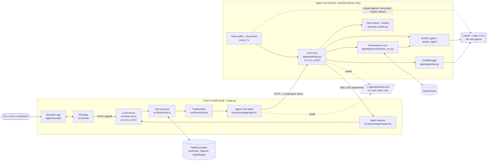
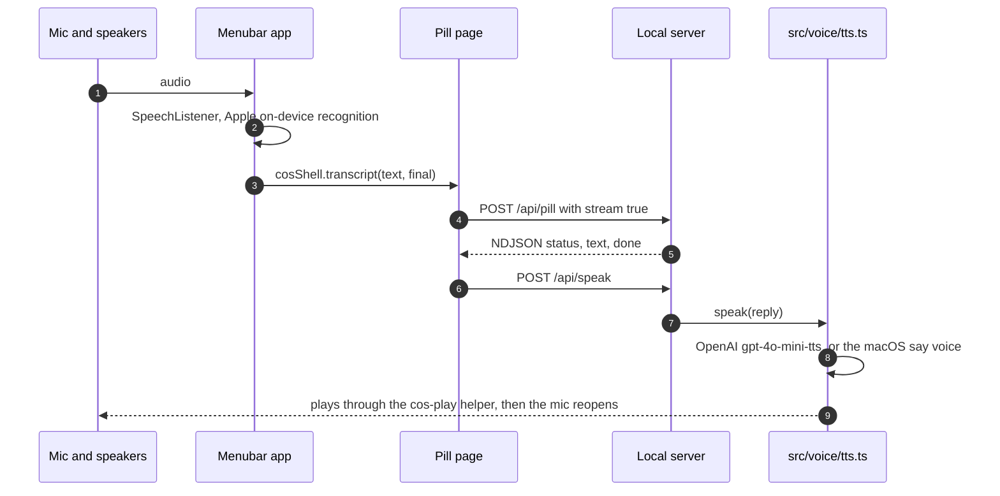
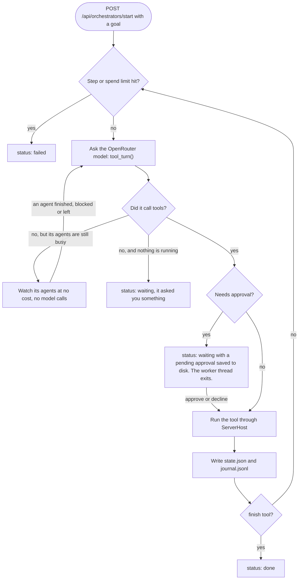
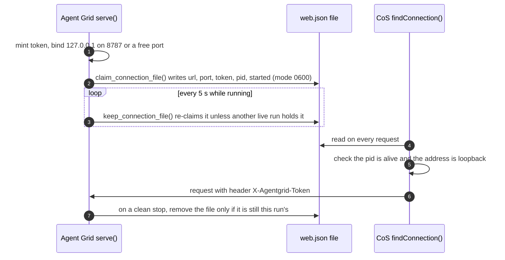
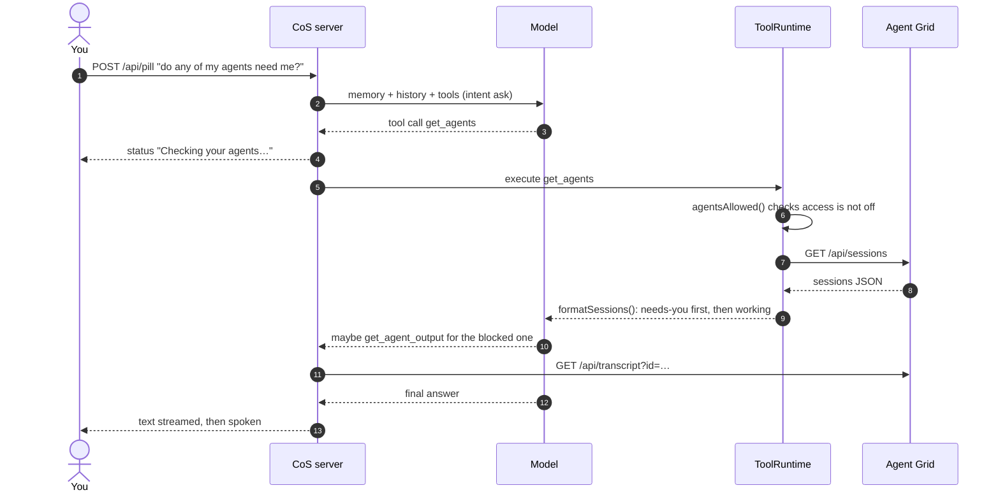
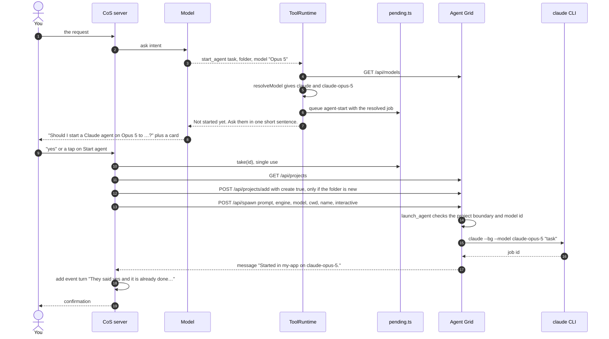
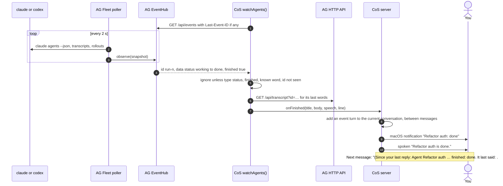
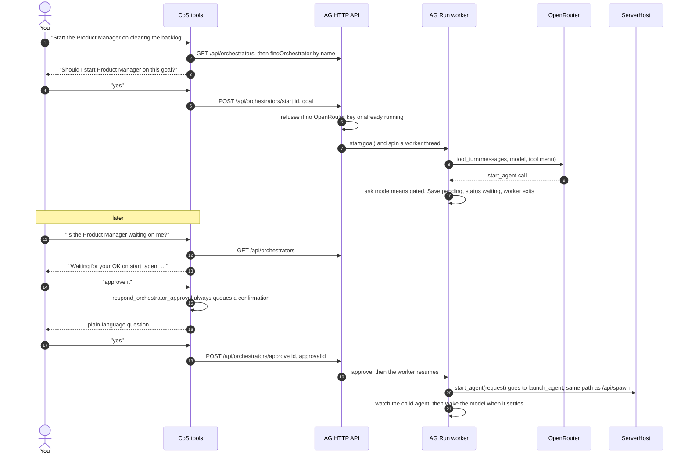

# How Chief of Staff and Agent Grid work (and work together)

A guided tour of two local programs: **Chief of Staff** (the assistant you talk to) and **Agent Grid**
(the dashboard that runs your Claude Code and Codex agents). It explains what each one is made of, how
Chief of Staff drives Agent Grid, and where the edges are.

Written against Chief of Staff `6fc6e92` and Agent Grid `3ecd6f8` (September 2026). File paths are
relative to each repo root: `~/Desktop/chief-of-staff` and `~/AgentGrid`. When the code and this
document disagree, the code wins.

**Contents:** 1 Big picture · 2 Chief of Staff · 3 Agent Grid · 4 How they connect ·
5 Frameworks and components · 6 The harnesses · 7 Tools · 8 How CoS knows and calls Agent Grid ·
9 Control, status, output, events, approvals, limits · 10 End-to-end flows · 11 Boundaries ·
12 Running it · 13 File index. A standalone HTML version of this document is
[`how-chief-of-staff-and-agentgrid-work.html`](how-chief-of-staff-and-agentgrid-work.html).

---

## The one-minute version

- **Chief of Staff (CoS)** is a personal assistant for your Mac. You talk to it (or type) in a small
  floating "pill". A local Node.js server sends what you said to a language model, which can call
  **tools**: read your calendar, run a terminal command, or work with your coding agents.
- **Agent Grid (AG)** is a local Python dashboard over every Claude Code and Codex session on the Mac.
  It finds sessions, starts new ones, chats with them, and keeps a ticket board. Its **orchestrators**
  are standing managers that start agents on their own.
- **CoS is a client of AG's HTTP API.** CoS never runs `claude` or `codex` itself. When you say "have
  an agent add a quiz to module 6", CoS asks AG to start that agent.
- **They find each other through one file**: `~/.agentgrid/web.json`. AG writes its address and a
  secret token there, and CoS reads it.
- **Traffic goes both ways.** CoS sends requests to AG (JSON over HTTP). AG pushes status changes back
  over a live stream (`GET /api/events`), which is how CoS can tell you when an agent is done.
- **Everything stays on this Mac.** Both servers listen on `127.0.0.1` only.
- **No agent framework.** Neither uses LangChain, LangGraph or an agent SDK. Each has a small
  hand-written loop, and the coding itself is done by the Claude Code and Codex CLIs (section 5).

---

## Words used in this document

| Word | Meaning |
|---|---|
| **Session** / **agent** | One Claude Code or Codex conversation doing work in a folder. AG shows each as a card. |
| **Engine** | Which CLI runs the agent: `claude` (Claude Code) or `codex`. |
| **Background / interactive** | Background agents run detached (`claude --bg`, `codex exec`). Interactive ones open in a Terminal tab you can type into. |
| **Orchestrator** | An AG "manager": a model on OpenRouter that can start and supervise real agents toward a goal. |
| **Persona / posting** | An orchestrator's identity (persona) placed on one team (posting). |
| **Work area** | A department-like group of agents in AG (Engineering, Marketing, …). |
| **Ticket** | A unit of work on AG's board, with an id like `APP-12`. |
| **Tool-use loop** | The model answers, asks to call a tool, gets the result, and repeats until it has a final answer. |
| **Tool** | A function the model may ask CoS to run, like `start_agent`. The model only asks. CoS code does the work. |
| **Pending action** | Something the model wants to do that waits for your OK first. |
| **Access mode** | How much CoS may do by itself for a capability: `off`, `ask` (default) or `auto`. |
| **SSE** | Server-sent events: one long HTTP response the server keeps writing events into. |
| **Loopback** | `127.0.0.1`, an address only programs on the same machine can reach. |
| **Token** | A random secret AG creates each time it starts. Every request must carry it. |

---

## 1. The big picture



How to read it: you talk to the **menubar app**. It shows the **pill page**, which sends your words to
the **local server**. The server runs the **tool-use loop** against your chosen model. When the model
asks for an Agent Grid tool, the **client** calls AG's HTTP API. AG does the work: it starts CLI
processes, sends chat turns, runs orchestrators, and edits tickets. Separately, AG's poller notices
status changes and streams them back to CoS's **watcher**.

---

## 2. Chief of Staff, layer by layer

### 2.1 What runs

| Piece | Language | Where | What it does |
|---|---|---|---|
| Menubar app | Swift (AppKit + WebKit) | `apps/menubar/Sources/ChiefOfStaff/` | The ✦ icon, hotkeys, on-device speech recognition, the floating pill window. Starts the local server. |
| Local server | TypeScript on Node.js | `src/ui/server.ts` (started by `cos ui`) | JSON API for the page, the tool-use loop, speech output, the Agent Grid watcher. |
| Pill page | Plain JS/HTML/CSS | `src/ui/web/` (`app.js`, `index.html`) | The chat UI. Runs inside the menubar app's web view, or in a normal browser with `cos ui`. |
| CLI | TypeScript | `src/cli/cos.ts` | `cos brief`, `cos ask`, `cos agents`, `cos orchestrators`, `cos access`, … Same functions the server uses. |
| Scheduler | launchd plists | `src/scheduler/launchd.ts` | Morning brief, evening wrap, silence check. Not involved with Agent Grid. |

The app and scheduler run a **copy** of the built CLI from `~/.cos/app` (or from inside a packaged
`.app`), not from the repo. macOS won't let a background process read code in `~/Desktop` without a
permission prompt. After code changes: `npm run build && npm run cos -- menubar refresh`.

### 2.2 The menubar app (Swift)

- `AppDelegate.swift` wires everything up. It builds the ✦ menu, including the **Agent Grid** submenu
  (drawn from `GET /api/grid`), and relays messages between the page and native code.
- `ServerManager.swift` starts `node <runtime>/dist/cli/cos.js ui --port <port> --no-open` if nothing
  answers yet. It pings `GET /api/projects` until the server is up. Port 4747 is the default, or the
  next free one (`ShellConfig.swift`). Server output goes to `~/.cos/logs/menubar-server.log`.
- `PillPanel.swift` is a borderless floating window with a `WKWebView` that loads
  `http://127.0.0.1:<port>/?shell=1&mode=pill`.
- `HotkeyMonitor.swift` handles double-tap Control (talk) and ⌥Space (type).
- `SpeechListener.swift` runs Apple's on-device speech recognition. `WakeListener.swift` and
  `WakePhrase.swift` listen for the wake name.

**The bridge between Swift and the page** works in both directions:

- Page → Swift: `window.webkit.messageHandlers.shell.postMessage({type: "listen" | "hide" | "height" | …})`.
- Swift → page: `panel.eval("cosShell.transcript(text, isFinal)")`, `cosShell.status(...)`, `cosShell.dismiss()`.
  `window.cosShell` is defined in `src/ui/web/app.js`.

### 2.3 The local server (Node.js)

`src/ui/server.ts` uses plain `node:http`, with no framework. `cos ui` binds it to `127.0.0.1` on port
4747 (`COS_UI_PORT` or `--port` change that). The endpoints that matter here:

| Endpoint | Purpose |
|---|---|
| `POST /api/pill` | One message from you. With `stream: true` the reply streams back as NDJSON (one JSON object per line): `start`, `status` ("Checking your agents…"), `text` deltas, then `done`. Messages are handled one at a time (`pillQueue`). |
| `POST /api/actions/confirm` | You tapped the button on a confirmation card (or Cancel). Runs the pending action. |
| `POST /api/speak`, `POST /api/speak/stop` | Say a reply out loud, or stop talking. |
| `GET /api/grid` | What the ✦ › Agent Grid menu shows: areas, agents, the ticket board in one line. Never throws. "Agent Grid is closed" is reported as a state. |
| `POST /api/grid/tickets/new` | File a ticket straight from the menu. Typing the title and pressing the button counts as your OK. |
| `GET/POST /api/conversation…` | The chat thread: current, new, aside, switch, rename, delete. |

When the server starts listening, it also starts the **Agent Grid watcher** (section 10.4), because
`cos ui` passes the `agentWatch` option.

### 2.4 Voice in and voice out



- Hearing: Apple's on-device recognizer in the menubar app. In a plain browser (`cos ui`), the page
  uses the browser's Web Speech API instead. No API key is needed for either.
- Speaking: `src/voice/tts.ts`. It uses OpenAI's TTS when `OPENAI_API_KEY` is set, otherwise the Mac's
  `say`. Audio plays through a small native player, `src/voice/player/cos-play.swift`.

### 2.5 The brain: one tool-use loop

`runIntent()` in `src/brain/loop.ts` is the heart of CoS. For each message it:

1. Builds **memory context**: the ledger, journal, calendar and git activity (`src/core/context.ts`),
   plus summaries of recent conversations (`src/brain/recall.ts`).
2. Picks a **prompt template** for the intent (`src/brain/prompts/*.md`): `ask`, `focus`, `capture`,
   `wrap` or `brief`.
3. Picks the **tools** that intent may use (`toolsFor()` in `src/brain/tools.ts`). Agent Grid tools
   are only available to `ask` and `focus`.
4. Calls the model through a provider-neutral interface (`src/brain/llm/types.ts`). Adapters live in
   `src/brain/llm/anthropic.ts` and `openai.ts`. OpenRouter and OpenAI-compatible servers use the OpenAI
   adapter. `registry.ts` chooses which one to use.
5. If the model asks for tools, it runs each one through `ToolRuntime.execute()`, appends the results,
   and asks again. It stops at a final answer or after 12 turns.

The conversation is saved in `~/.cos/conversations` (`src/brain/conversation.ts`). Besides `user` and
`assistant` turns there are **`event` turns**: things that happened outside the chat, like "you tapped
Start agent" or "agent X finished". The next message to the model starts with
`(Since your last reply: …)`, so the model knows about those events.

### 2.6 The tool layer: CoS's Agent Grid tools

All tool definitions (name, description, JSON schema) and their implementations are in
`src/brain/tools.ts`. The HTTP calls are in `src/actions/agentgrid.ts`, class `AgentGrid`.

| Tool the model calls | What it does | Agent Grid endpoints used | Needs your OK? |
|---|---|---|---|
| `get_agents` | Lists sessions, those that need you first | `GET /api/sessions` | No, read-only |
| `get_agent_output` | Reads the end of one transcript (about the last 10,000 characters) | `GET /api/sessions`, `GET /api/transcript?id=` | No |
| `get_agent_models` | Lists the models each engine can use | `GET /api/models` | No |
| `start_agent` | Starts a Claude Code or Codex agent | `GET /api/models`, `/api/areas`, `/api/tickets` (to resolve names), `GET /api/projects`, `POST /api/projects/add`, `POST /api/spawn` | In `ask` mode |
| `message_agent` | Sends a follow-up to a session | `POST /api/chat` | In `ask` mode |
| `get_work_areas` | Areas → agents in each → the tickets they hold | `GET /api/areas`, `/api/sessions`, `/api/tickets` | No |
| `get_tickets` | The board, filtered, or one ticket in full | `GET /api/tickets` | No |
| `change_ticket` | Create, edit, move, assign, comment on or delete a ticket | `POST /api/tickets/{create,update,move,assign,comment,delete}` | In `ask` mode. **Delete always asks.** |
| `get_orchestrators` | Every orchestrator's status, or one in full | `GET /api/orchestrators` | No |
| `start_orchestrator` | Starts an existing orchestrator on a goal | `POST /api/orchestrators/start` | In `ask` mode |
| `stop_orchestrator` | Stops one | `POST /api/orchestrators/stop` | In `ask` mode |
| `message_orchestrator` | Adds a message it reads on its next step | `POST /api/orchestrators/send` | In `ask` mode |
| `respond_orchestrator_approval` | Approves or declines the one tool call an orchestrator is holding | `POST /api/orchestrators/approve` or `/decline` | **Always**, whatever the mode |

Helpers that turn AG's raw data into text the model can read:

- `src/actions/agentgrid.ts`: `formatSessions`, `formatTranscript`, `findSession` (match by id prefix or
  title words), `resolveModel` ("Opus 5" → `claude-opus-5`), `formatOrchestrator(s)`, `findOrchestrator`.
- `src/actions/gridboard.ts`: joins areas, sessions and tickets into one tree. Also parses spoken
  statuses ("in review" → `review`) and ticket ids ("dc12" → `DC-12`). It makes no network calls, so it
  is easy to test.
- `src/actions/tickets.ts`: `planTicketChange` resolves every reference (a title → an id, "the MLG
  agent" → a session id) **before** you're asked. `performTicketChange` then runs exactly the plan you
  approved.

### 2.7 Guard rails: access modes and pending actions

CoS decides what it may do on its own. The model doesn't get to decide.

**Access modes** (`src/actions/access.ts`, saved in `~/.cos/access.json`, changed with `cos access`):

| Capability | Default | `off` | `ask` | `auto` |
|---|---|---|---|---|
| `agents` (all of Agent Grid) | `ask` | Every AG tool fails with "Agent Grid access is off". The watcher hangs up. | Reads run freely. Anything that changes something waits for your OK. | Changes run straight away, except ticket deletes and orchestrator approvals. |

**Pending actions** (`src/actions/pending.ts`): when a change needs your OK, the tool doesn't run it.
It queues a `Pending` with a random id, a one-line label, the exact details, and a button word
("Start agent"). The tool then returns an instruction to the model, like *"Not started yet. Ask them in
one short sentence…"*. The reply carries a confirmation card.

There are three ways to answer:

1. **Tap the button**: `POST /api/actions/confirm {id}` → `performPending()` (`src/actions/perform.ts`).
2. **Say a clear yes or no**: before the model even runs, `settlePending()` in `server.ts` uses
   `readConsent()` (`src/actions/consent.ts`) to recognize "yeah, send it" or "no, leave it", and acts on it.
3. **Give a mixed answer** ("yes, but make it shorter"): this goes to the model, which may call
   `confirm_pending`. That tool must be the model's first call in its reply.

Pending actions are **single-use**, **expire after 5 minutes**, and live **in the server's memory**.
The model can't confirm its own request: only a button tap or your words can. `repeated()` in
`tools.ts` also refuses to queue the same action twice, or to redo one that ran in the last 15 minutes.

### 2.8 CoS state on disk (for reference)

| Path | Holds |
|---|---|
| `~/selfhub/` (`COS_SELFHUB`) | Long-term memory: ledger, journal, reminders, notes. Plain markdown in git. |
| `~/.cos/conversations/` | Saved chats, including the `event` lines about agents. |
| `~/.cos/access.json` | Access modes. |
| `~/.cos/.env` | API keys (owner-only). Never sent to Agent Grid. |
| `~/.cos/logs/` | `menubar-server.log`, `terminal.log`, … |

---

## 3. Agent Grid, layer by layer

### 3.1 What runs

`python3 -m agentgrid --web` from `~/AgentGrid` (or `ag --web` through `bin/ag`) calls `serve()` in
`agentgrid/web.py`. It uses only Python's standard library: no pip, no build step. It starts:

- a **`Fleet`** poller thread that refreshes the list of sessions every 2 seconds (`POLL_SECONDS`);
- a **`ThreadingHTTPServer`** on `127.0.0.1:8787`, or on a free port if 8787 is taken;
- a **`ChatManager`** (`agentgrid/chat.py`) for chat turns with sessions;
- a **`RunManager`** (`agentgrid/orchestrator_run.py`) for orchestrators. On startup it resumes any run
  the last shutdown interrupted;
- a small thread that keeps `~/.agentgrid/web.json` pointing at this run (section 4.1).

Plain `ag` shows the same data as a curses grid in the terminal (`agentgrid/ui.py`). CoS only talks
to the web server.

### 3.2 The security gate

Every request must carry the per-run token, either as `?t=<token>` or in the `X-Agentgrid-Token`
header. `Handler._authorized()` compares it with `secrets.compare_digest`. Anything else gets
`403 {"error": "Bad or missing token."}`. Responses also send `X-Frame-Options: DENY` and
`Referrer-Policy: no-referrer`. The token is new every time AG starts.

### 3.3 Finding sessions: `discovery.py`

AG doesn't scrape screens. `discovery.collect()` combines:

| Source | Gives |
|---|---|
| `claude agents --json --all` | Which Claude sessions exist, and their state or status, cwd, pid, job id |
| Transcripts on disk (`~/.claude/projects/…/*.jsonl`, read incrementally) | Title, model, last prompt, tool counts, last activity |
| `~/.claude/jobs/<id>/state.json` → `tempo` | Whether a background job is really working right now |
| `~/.codex/sessions/` rollouts + `session_index.jsonl` | Codex sessions, titles, models, and "working" inferred from open tasks |
| `~/.agentgrid/state.json` (written by `hooks/agentgrid_notify.py`, a Claude Code Notification hook) | Which interactive sessions are stuck at a prompt, so they show as "Needs you" |
| `names.json`, `overrides.json`, `read.json`, `tags.json` in `~/.agentgrid/` | Your names, manual card moves, unread positions, tags |

`normalize_status()` merges the CLI's two vocabularies into one. Background sessions report
`working/blocked/done/failed/stopped`; interactive ones report `busy/idle/waiting`, which become
`working/idle/blocked`. `Fleet._as_json()` is the session shape CoS receives from `/api/sessions`:
`sessionId, title, customName, status, engine, model, cwd, project, prompt, idleSeconds, …`.

### 3.4 Starting agents: `launch_agent()` and `spawn_agent()`

Both the New agent sheet (`POST /api/spawn`) and an orchestrator's `start_agent` tool go through
`launch_agent()` in `web.py`. That's why an agent an orchestrator started looks exactly like one you
started by hand.

`launch_agent()`:

1. Checks the work area exists (`areaId`).
2. If `ticketKey` is set, puts the ticket's handoff brief (`tickets.handoff_prompt`) in front of the
   task. The brief includes the `ag ticket` commands the agent should use to report back.
3. Resolves the folder. `noProject: true` means `~/Desktop` (or `~` if there's no Desktop); otherwise it
   uses `cwd`.
4. Calls `spawn_agent()`. That **refuses any folder that isn't a known project** (discovered git repos,
   folders the fleet already works in, or folders added by hand). It also refuses a model id that isn't
   well-formed.
5. Registers the area membership, assigns the ticket (moving it to In progress), and names the session
   once it appears.

`spawn_agent()` has three shapes:

| Shape | Command | Notes |
|---|---|---|
| Claude, background (default) | `claude --bg [--model M] <prompt>` in the folder | Prints a job id, which AG uses to name the session later. |
| Codex, background | `codex exec --cd <dir> -s workspace-write --skip-git-repo-check [-m M] <prompt>`, detached | Prints no job id, so the name is matched by folder and start time. |
| Interactive (macOS) | A Terminal.app tab running `claude <prompt>` or `codex <prompt>` | Every argument is shell-quoted. Opened through AppleScript. |

A model AG hasn't seen on this Mac is checked for up to 10 seconds. If the CLI refuses it, AG says so
and starts nothing. Spawned agents get `AGENTGRID_AGENT=<name>` in their environment, and
`OPENROUTER_API_KEY` is removed from it (`agent_env()`).

### 3.5 Talking to a session: `POST /api/chat` → `chat.py`

A message to an existing session is a **new headless turn** of the CLI, resumed on that session:

- Claude: `claude -p <message> --output-format stream-json --verbose --permission-mode <posture> --resume <sessionId>`
- Codex: `codex exec -s workspace-write -c approval_policy="never" resume --json … <sessionId> <message>`

`cwd` always comes from the session AG tracks, never from the caller. The default posture is `auto`,
which maps to `--permission-mode bypassPermissions`. CoS sends no posture, so it gets this default.
One turn runs per session at a time. Messages sent during a turn wait in a queue.

### 3.6 Transcripts: `GET /api/transcript?id=`

`transcript.render_blocks()` turns the session's JSONL file into typed blocks:
`{kind: user|assistant|tool|result|thinking, text, name, gist, error}`. The file is opened read-only,
so reading a live session is safe. CoS uses these blocks for `get_agent_output` and to quote an
agent's last words when it finishes.

### 3.7 The event stream: `EventHub` and `GET /api/events`

`EventHub` in `web.py` is the push side of the integration.

- After every 2-second poll, `Fleet._announce()` shows the snapshot to `EventHub.observe()`. The
  snapshot includes live chat turns, so a session AG is chatting with counts as `working`.
- For each session whose status changed since the last poll, it creates an event:

  ```
  id: 3f9a2c1d-7
  data: {"type":"status","sessionId":"…","title":"Refactor auth","engine":"claude",
         "cwd":"/Users/you/Desktop/my-app","project":"my-app",
         "from":"working","to":"done","finished":true,"at":"2026-09-15T18:40:12"}
  ```

- `finished` is true when the session was `working` and settled into `done`, `failed`, `blocked`,
  `idle`, `stopped` or `complete`.
- Ids look like `<run>-<n>`. The run prefix changes on every AG restart. The last 200 events are kept.
  A client that reconnects with `Last-Event-ID` from the same run gets every event it missed, and no
  event twice.
- A `: ping` comment is sent every 15 seconds as a heartbeat.

### 3.8 Work areas and tickets

- **Areas** (`agentgrid/areas.py`, `~/.agentgrid/areas.json`) hold the list of areas and a `members`
  map from session id to area. An area doesn't list its agents directly. That's why CoS's
  `gridboard.ts` does the join.
- **Tickets** (`agentgrid/tickets.py`, one JSON file per ticket under `~/.agentgrid/tickets/`) have a
  per-project key and number (`APP-12`), five statuses, type, priority, assignee, labels and an
  activity log. Agents use the `ag ticket …` CLI (`agentgrid/ticket_cli.py`) to take, comment on and
  move tickets from their own shell.
- **Assigning to a live session** (`/api/tickets/assign`) also sends the ticket's handoff brief into
  that agent's chat (through `ChatManager`). An assignment to a bare name is just a label.

### 3.9 Orchestrators

An orchestrator is **not a session**. It's a manager that starts sessions. Its code is split up:

| File | Role |
|---|---|
| `agentgrid/personas.py` | Who it is: guidelines, the OpenRouter model it thinks with, agent defaults, allowed models, team, skills, lessons. |
| `agentgrid/orchestrator.py` | Where it works (a *posting*): scope (a work area, or `""` for all), project, mode `ask`/`auto`, limits. Data and files only: no network, no threads. |
| `agentgrid/orchestrator_brief.py` | What the model is told: the system prompt and the **tool menu**. |
| `agentgrid/orchestrator_run.py` | How it behaves: the loop, gates, limits, persistence, watching its agents. |
| `agentgrid/openrouter.py` | The one network call: `tool_turn()` to OpenRouter. The key comes from the macOS Keychain (`credentials.py`), or from `OPENROUTER_API_KEY` on other systems. |
| `ServerHost` in `web.py` | The orchestrator's **only door** to the machine. Each method is something the UI can already do. |

**The tool menu** the orchestrator's model gets: `list_projects`, `list_work_areas`,
`create_work_area`, `start_agent`, `list_agents`, `read_agent_output`, `send_to_agent`,
`wait_for_agents`, `list_tickets`, `create_ticket`, `move_ticket`, `comment_ticket`, `set_plan`,
`remember`, `message_user`, `read_skill`, `read_prompt`, `finish`. There's no shell, no filesystem
access and no editor.

**The run loop** (`Run._step()`):



Key rules, all enforced in code (none of this is left to the model):

- **Approval gates** (`_gate_reason`): in `ask` mode, `start_agent` and `create_work_area` wait for you.
  In `auto` mode, opening an **interactive** Terminal tab still asks, unless the persona's default is
  interactive. A request that would be refused anyway (a model outside the allowed list, say) is
  refused outright, without asking you.
- **Limits** (defaults): 3 agents at once, 20 agents per run, 200 steps, $5 of the orchestrator's own
  OpenRouter spend. The agents it starts run on your normal Claude Code and Codex logins.
- **Durability**: after every step the state is written to `~/.agentgrid/orchestrators/<id>/state.json`,
  with an append-only `journal.jsonl` beside it. A pending approval survives a restart. A run interrupted
  mid-step resumes, and the model is told to check `list_agents` and `list_tickets` before starting
  anything, so it doesn't start the same agent twice.
- **Statuses**: `idle`, `running`, `waiting` (needs you), `done`, `failed`, `stopped`.

### 3.10 Agent Grid state on disk

```
~/.agentgrid/
├── web.json            # where to reach this run: url, port, token, pid (owner-only)
├── state.json          # the Notification hook's record of who is waiting
├── names.json, tags.json, overrides.json, read.json
├── areas.json          # work areas + which session sits where
├── projects.json       # folders added by hand, favorites, hidden
├── agents.json         # the saved agent library
├── models.json         # models this Mac has actually used
├── tickets/            # one JSON per ticket + _meta.json (keys and counters)
├── orchestrators/<id>/ # definition, state.json, journal.jsonl, memory
├── personas/           # one JSON per persona
└── notes/              # the daily notepad
```

---

## 4. How the two connect

### 4.1 Finding each other: `~/.agentgrid/web.json`



Details that matter:

- **The override.** `AGENTGRID_URL=http://127.0.0.1:8787/?t=…` in CoS's environment replaces the file
  (`findConnection()` in `src/actions/agentgrid.ts`).
- **Loopback only.** CoS refuses any base URL other than `http://127.0.0.1` or `http://localhost`.
- **Read every time.** CoS calls `findConnection()` per request (and per event-stream connection), so
  an AG restart with a new token is picked up without restarting CoS.
- **Two AG instances.** A second `ag --web` (a test run on a spare port, say) won't take the file from
  a run that still answers `GET /api/ping` with its own token. CoS keeps talking to the first run.

### 4.2 The request contract

`AgentGrid.call()` in `src/actions/agentgrid.ts`:

- `GET` when there is no body, otherwise `POST` with a JSON body.
- Headers: `X-Agentgrid-Token: <token>`, plus `content-type: application/json` on POSTs.
- Timeout: 15 s, or 90 s for `/api/spawn`, because starting an agent (and checking its model) can take
  a while.
- Errors come back in plain words:

| What happened | What CoS says |
|---|---|
| Connection refused | "Agent Grid isn't running. Start it with `python3 -m agentgrid --web` from ~/AgentGrid." |
| No `web.json` | "Agent Grid hasn't shared its connection yet…" |
| `403` | "Agent Grid rejected the key: it was probably restarted…" |
| `404` on `/api/events` or `/api/orchestrators` | "This Agent Grid can't … yet: update it from ~/AgentGrid and restart it." |
| Other non-2xx | AG's own `{"error": "…"}` text, e.g. "That directory is not one of the known projects." |

### 4.3 Endpoint map

| CoS `AgentGrid` method | HTTP | AG handler | Effect |
|---|---|---|---|
| `sessions()` | `GET /api/sessions` | `_sessions_snapshot()` | Fleet snapshot with live chat overlaid |
| `projects()` | `GET /api/projects` | `discover_projects()` | Folders agents may run in |
| `start(o)` | `POST /api/projects/add` then `POST /api/spawn` | `add_project()`, `_spawn()` → `launch_agent()` | New agent |
| `models()` | `GET /api/models` | `models.py` | Model catalog per engine |
| `transcript(id)` | `GET /api/transcript?id=` | `_get_transcript()` | Transcript blocks |
| `message(id, text)` | `POST /api/chat` | `_chat_send()` → `ChatManager.send()` | A headless resumed turn |
| `areas()` | `GET /api/areas` | `areas.load()` | Areas + members |
| `board()` | `GET /api/tickets` | `tickets.py` | All tickets + facets |
| `createTicket/updateTicket/moveTicket/assignTicket/commentTicket/deleteTicket` | `POST /api/tickets/{create,update,move,assign,comment,delete}` | `_tickets_*` | Ticket changes. Assigning to a live session also messages it. |
| `events()` | `GET /api/events` (SSE) | `_events_stream()` | Status changes |
| `orchestrators()` | `GET /api/orchestrators` | `_orchestrators()` → `Run.snapshot()` | Definitions + run state |
| `startOrchestrator / stopOrchestrator / sendOrchestrator` | `POST /api/orchestrators/{start,stop,send}` | `_orchestrator_action()` → `Run.start/stop/submit` | Run control |
| `answerOrchestrator` | `POST /api/orchestrators/{approve,decline}` | `Run.approve/decline` | Resolves the pending approval |
| `pageUrl()` | (none) | (none) | Builds the signed-in board URL for the menu |

---

## 5. Frameworks and components: what's custom, what's borrowed

**Short answer: neither codebase uses LangChain, LangGraph, LlamaIndex, CrewAI, AutoGen, the Claude
Agent SDK or any other agent framework.** Both dependency lists and all imports were checked.
Agent Grid's `agentgrid/teams.py` even says so in its docstring: *"No SDK, no API key, no LangGraph
-- Claude Code already is the agent; this only decides who runs, in what order, and what each one is
told."*

Every loop in the system is hand-written and short. The hard part of "being an agent" (reading code,
editing files, running a shell) is done by the **Claude Code and Codex CLIs**. Agent Grid launches them,
feeds them turns, and reads what they write to disk, but treats them as black boxes.

```
Layer                         Written by           Where
────────────────────────────  ───────────────────  ──────────────────────────────────────────────
Your assistant's loop         custom (CoS)         src/brain/loop.ts  runIntent()
Model API clients (CoS)       third-party SDKs     @anthropic-ai/sdk, openai
Agent manager + board         custom (AG)          agentgrid/web.py, discovery.py, chat.py
Orchestrator loop             custom (AG)          agentgrid/orchestrator_run.py  Run
Orchestrator model API        custom HTTP client   agentgrid/openrouter.py  (urllib, no SDK)
The coding agents themselves  third-party CLIs     claude (Claude Code), codex
```

### 5.1 Chief of Staff

Third-party packages (all of `package.json`):

| Package | Used for | Where |
|---|---|---|
| `@anthropic-ai/sdk` | Claude Messages API, streamed with `client.beta.messages.stream()` | `src/brain/llm/anthropic.ts` |
| `openai` | Chat Completions for OpenAI, for OpenRouter (same client with `baseURL: https://openrouter.ai/api/v1`) and for any OpenAI-compatible server. Also OpenAI text-to-speech. | `src/brain/llm/openai.ts`, `createProvider()` in `registry.ts`, `src/voice/tts.ts` |
| `@modelcontextprotocol/sdk` | MCP client over stdio | `src/actions/browser.ts`, `src/actions/mcp.ts` |
| `@playwright/mcp` | The browser automation server behind the assistant's own browser | `src/actions/browser.ts` |
| `commander` | Parsing the `cos` command line | `src/cli/cos.ts` |
| `typescript`, `tsx`, `vitest`, `@types/node` (dev only) | Build, run, test | — |

The rest of the stack is platform pieces:

- **Apple frameworks:** AppKit and WebKit (menubar app, pill), Speech and AVFoundation (listening),
  EventKit (`src/sensors/eventkit/cos-calendar.swift`), ScreenCaptureKit (`src/sensors/screen/cos-screen.swift`).
- **Tools on the Mac:** `git`, `say`, `open`. Optionally `whisper-cli` with `rec` or `ffmpeg` for
  `cos talk`, and `icalBuddy`.

Custom, written for this repo:

- **The loop and its contract.** The tool-use loop and a provider-neutral message format:
  `runIntent()`, and `ChatRequest`, `ChatResponse`, `ToolSpec` in `src/brain/llm/types.ts`.
- **The provider translation.** `buildAnthropicParams()`, `parseAnthropicMessage()`,
  `buildCompatParams()`, `parseCompletion()` and `strictSchema()`.
- **Model choice.** `resolveModel()` in `registry.ts` picks a model in this order: the `--model`
  flag, then the per-intent choice, the saved default, `COS_MODEL`, and finally the first provider
  with a key.
- **Tools.** The registry and dispatcher: `TOOLS`, `toolsFor()`, `ToolRuntime.execute()` and `dispatch()`.
- **Guard rails.** `access.ts`, `pending.ts`, `consent.ts`, and the terminal rules
  (`classifyCommand()` and `decide()` in `terminal.ts`).
- **Memory.** The conversation store and recall: `conversation.ts`, `recall.ts`.
- **The Agent Grid client.** It includes its own server-sent-events parser, `SseParser`, rather than
  an EventSource library.
- **Everything around it.** The HTTP server on plain `node:http`, the vanilla JS page and the Swift app.

### 5.2 Agent Grid

**Agent Grid has no third-party Python packages, by design.** The README explains that `pip install`
did not work on the network it was built for. Everything in `agentgrid/*.py` is custom:

- **The server.** It runs on `http.server.ThreadingHTTPServer` and writes its own server-sent events.
- **Session discovery.** `discovery.py`.
- **The CLI driver.** It turns each CLI's JSON output into one event vocabulary:
  `chat.normalize()` and `normalize_codex()`.
- **The orchestrator loop.** `orchestrator_run.py`.
- **The OpenRouter client.** `openrouter.request()` and `tool_turn()`, both on `urllib.request`.
- **Keychain access.** `ctypes` calls into Security.framework, in `credentials.py`.
- **A small YAML front-matter parser** for skills: `skills.front_matter()`.
- **The terminal grid** (`ui.py`) and **the board page** (`static/app.html`, vanilla JS).
- **The pipeline runner.** `teams.TeamRun`.
- **The ticket store and its CLI.** `tickets.py`, `ticket_cli.py`.

What it leans on from outside:

| External piece | How Agent Grid uses it |
|---|---|
| `claude` CLI (Claude Code) | `claude agents --json --all` (discovery), `claude --bg` (start), `claude -p … --resume` (chat turns), `claude logs` / `claude rm` (the unknown-model check), `claude attach` (Open) |
| `codex` CLI | `codex exec` (start), `codex exec resume --json` (chat turns), and its rollout files under `~/.codex/sessions/` |
| Claude Code hooks | `hooks/agentgrid_notify.py`, a Notification / UserPromptSubmit hook that marks sessions waiting on you |
| Terminal.app via AppleScript | Interactive agents (`_open_terminal_tab()`) |
| OpenRouter HTTP API | Orchestrators, the `openrouter` chat engine, and team nodes on that engine |
| OpenAI HTTP API | A small voice-command trial (`voice.py`, key from the environment) |
| `git` | File lists for the `@` mention picker, and notes sync |

### 5.3 What this means in practice

- **There is no graph runtime.** Nothing checkpoints or plans on your behalf. Each loop is a `while`
  with explicit exits, and its state is plain JSON you can open. CoS keeps conversations in
  `~/.cos/conversations`. AG keeps each run in `~/.agentgrid/orchestrators/<id>/state.json`.
- **Swapping models is cheap.** CoS talks to every provider through one small interface.
  AG's orchestrators only need an OpenRouter model id.
- **Agent quality belongs to the CLIs.** Neither program changes how Claude Code or Codex reason or use
  their tools. AG only controls what they are asked, in which folder, with which flags, and when.

---

## 6. The harnesses in depth

"Harness" here means the code that owns a model loop: it builds the prompt, offers tools, runs them,
enforces limits and decides when to stop. The system has four:

| | CoS assistant loop | AG orchestrator loop | AG chat driver | AG team pipeline |
|---|---|---|---|---|
| Code | `runIntent()` in `src/brain/loop.ts` | `Run._work()` / `Run._step()` in `orchestrator_run.py` | `ChatSession._run_turn()` in `chat.py` | `TeamRun` in `teams.py` |
| Model | Anthropic, OpenAI, OpenRouter or OpenAI-compatible | OpenRouter only (`openrouter.tool_turn()`) | Whatever the CLI uses (or an OpenRouter model for the `openrouter` engine) | CLI sessions, one per node |
| Who owns the loop | CoS: until a final answer or 12 turns | AG: until `finish`, a limit, a stop or a gate | The CLI runs its own agent loop. AG runs one turn at a time | AG: nodes in order, plus bounded loops |
| Tools | `TOOLS`, run by `ToolRuntime` | `tool_specs()`, run by `Run._tool_*` through `ServerHost` | The CLI's own (Bash, Edit, …) | The CLI's own |
| Lifetime | One message (one HTTP request) | Long-lived, written to disk, resumable | One subprocess per turn, with a queue in memory | One run |
| Human gate | Pending actions (5 min, in memory) | A pending approval in `state.json` (no expiry) | Posture: `auto` (bypass permissions) or `read-only` (plan mode) | Posture per node |
| Streams out | Text deltas → NDJSON to the pill | Journal events → `GET /api/orchestrators/stream` | Normalized events → `GET /api/chat/stream` | Node-tagged events → `GET /api/teams/stream` |
| Used by CoS? | It *is* CoS | Yes, through the orchestrator tools | Yes, `message_agent` and ticket assignment go through it | No |

### 6.1 Chief of Staff: `runIntent()`

```
instructions = PERSONA + "# Task" + src/brain/prompts/<intent>.md   same on every call, so it can be cached
context      = "# Memory" + renderContext(bundle) + recall           changes on every call
messages     = historyMessages(convo)
             + { user: "(Since your last reply: …)\n\n<what you said>", images? }
tools        = toolsFor(intent)          serverTools = serverToolsFor(intent)

up to 12 times:
  res = provider.chat({ model, instructions, context, messages, tools, serverTools,
                        json?, effort, maxTokens: 16000 }, onText)
  refusal  → throw RefusedError
  pause    → keep going (a provider-side tool paused mid-answer)
  no calls → stop
  for each tool call, in order:
      onTool(name)                        → the pill shows "Checking your agents…"
      runtime.execute(name, input)        → { id, content, isError }
  append the assistant turn (with providerData) and the tool results
  a screenshot, if any, goes in as a separate user message

return { text, toolCalls, pending, done, steps, model, webSearches }
```

Details worth knowing:

- **Errors stay inside the loop.** `ToolRuntime.execute()` catches every exception and returns
  `Error: <message>` with `isError: true`. The model reads the failure and can adjust, for example
  "Agent Grid access is off. They can turn it on with `cos access agents ask`."
- **Replay within a run.** `providerData` carries Anthropic thinking blocks, or OpenRouter reasoning
  details, back to the same provider on the next turn.
- **Replay across messages.** `steps` (the tool calls and results, without provider data) are saved
  with the reply. Later, `historyMessages()` replays at most 12 exchanges and 24,000 characters, and
  cuts each tool result to 1,500 characters.
- **Anthropic specifics.** The system prompt goes in as two blocks. The first (persona and task) has
  `cache_control: ephemeral`, and the second holds memory. Models that support it get adaptive
  thinking plus the `COS_EFFORT` level. The morning brief asks for JSON through
  `output_config.format`.
- **OpenAI-compatible specifics.** Tools go in as `{type: "function", function: {…}}`. The JSON brief
  uses `response_format` with `strictSchema()`, and the request is retried without it if a server
  rejects it.
- **Web search.** It's a server-side tool: Anthropic's `web_search` tool, or `openrouter:web_search`.
  The provider runs it, and CoS never sees the call. OpenAI's own endpoint and local servers go
  without. Only the `ask` and `focus` intents get it, limited to 3 results and 4 searches.

### 6.2 Agent Grid: an orchestrator `Run`

```
POST /api/orchestrators/start ─► Run.start(goal)
    state = blank_state() + {status: running, goal, messages: [system, "Goal: …"]}
    _spin() ─► one worker thread (guarded by _active) ─► _work(): while not cancelled: _step()

_step():
    an approval was answered?  → _apply_decision(): run or decline the held call, then the rest of that turn
    _drain_inbox()             → your messages become user turns
    _limit_hit()               → steps ≥ max_steps or cost ≥ max_spend_usd → _finish("failed")
    messages[0] = system_prompt(_context())             rebuilt every step from persona and posting
    turn = openrouter.tool_turn(trim_messages(messages), persona.model, tool_specs(context))
    steps += 1, costUsd += usage.cost, _persist()
    no tool calls → _after_prose(): watch busy children for free, or status = waiting
    else _run_calls():
        start_agent? → _shape_start(): fill engine, model and mode from the persona's defaults
        _gate_reason(call) → _request_approval(): status = waiting, pending saved, worker exits
        otherwise _invoke(call) → Run._tool_<name>(args) → _record_result() (≤ 20,000 characters)
        finish called → _finish("done")
```

- **Threads.** HTTP threads call `start`, `stop`, `submit`, `approve` and `decline`. One worker thread
  per run makes the model calls. `_wake` (a `threading.Event`) cuts a wait short when you send a
  message, and `_cancel` handles stop. A worker that has nothing to do exits, and the next action
  restarts it.
- **Context.** `trim_messages()` always keeps the system prompt and the goal. It fills up to 120,000
  characters with the newest messages and drops tool results whose call was cut off.
- **Durability.** `orchestrator.write_state()` runs after every change. At startup,
  `RunManager.resume_all()` restarts interrupted runs. `repair_messages()` removes a half-finished
  tool turn, so a side effect is never repeated blindly.
- **Failures.** A tool that raises `ValueError` returns `{"ok": false, "error": …}` to the model. Any
  other exception becomes "That tool failed on this machine." with no traceback. OpenRouter errors
  fail the run. The provider's own error text isn't passed on, because it can echo the request back.
- **Free waiting.** `_watch()` checks the board every 3 seconds (`WATCH_POLL_SECONDS`) with no model
  calls. `_tell_model()` wakes the model with the change and the last 1,500 characters of the agent's
  output.

### 6.3 Agent Grid: driving the CLIs (`chat.py`)

`ChatManager` keeps one `ChatSession` per session id. `send()` queues a message, and `_drain()` runs
turns one at a time. `_run_turn()` starts the CLI as a subprocess in its own process group, so it can
be cancelled cleanly, and reads its output line by line. `normalize()` and `normalize_codex()` turn
each JSON line into one small vocabulary: `turn_started`, `assistant_message`, `thinking`,
`tool_use`, `tool_result`, `turn_done`, `error`. The board streams these from `GET /api/chat/stream`.

CoS doesn't subscribe to that stream. It sees a chat turn only indirectly: `_overlay_chat()` marks the
session `working` in `/api/sessions` and `/api/events`, and the transcript grows on disk.

### 6.4 Agent Grid: team pipelines (`teams.py`, `workflows.py`)

A team is a JSON pipeline of nodes, and each node is a persistent `ChatSession`. Prompts are
templates over `{input}` and `{node_id}`, and loops jump back to an earlier node while a marker such as
`NEEDS_WORK` appears, up to a set number of times. `workflows.DraftManager` turns a written description
into a team draft. CoS has no tools for teams.

---

## 7. Tools: how they are defined, found and exposed

### 7.1 Chief of Staff's tools

**Definition.** Every tool is one entry in `TOOLS: Record<string, ToolSpec>` in `src/brain/tools.ts`:
a name, a description written for the model, and a JSON Schema. For example:

```ts
message_agent: {
  name: "message_agent",
  description: "Send a message to an Agent Grid session: answer an agent that needs the user, " +
               "or give it a follow-up task. May wait for the user's OK.",
  parameters: { type: "object",
    properties: { session: s("Session id or part of its title"), message: s("What to tell the agent") },
    required: ["session", "message"] },
},
```

**The catalog** has 38 tools, all fixed when the code is built:

| Group | Tools |
|---|---|
| Memory (writes) | `upsert_project`, `skip_cadence`, `touch_project`, `add_reminder`, `complete_reminder`, `add_note`, `append_journal`, `add_shortcut` |
| Reading your world | `get_project`, `get_calendar`, `get_conversations`, `find_folder`, `find_bookmarks`, `get_git_log`, `look_at_screen` |
| Acting on the Mac | `open`, `run_command`, `confirm_pending` |
| Agent Grid (13) | `get_agents`, `get_agent_output`, `get_agent_models`, `start_agent`, `message_agent`, `get_work_areas`, `get_tickets`, `change_ticket`, `get_orchestrators`, `start_orchestrator`, `stop_orchestrator`, `message_orchestrator`, `respond_orchestrator_approval` |
| Its own browser | `browser_open`, `browser_read`, `browser_click`, `browser_type`, `browser_select`, `browser_scroll`, `browser_back` |

**Exposure per intent** (`toolsFor(intent)`):

| Intent | Tools offered |
|---|---|
| `brief`, `silence-check` | None. The brief is read-only and returns JSON. |
| `ask` (the pill's default) | All 38, plus provider web search |
| `focus` | A subset, including every Agent Grid tool, plus web search |
| `capture` | The memory writes, `get_project`, `get_calendar`, `find_folder` |
| `wrap` | Journal and ledger tools, `get_git_log`, `get_conversations` |

**Translation per provider.** The Anthropic adapter sends `{name, description, input_schema}`. The
OpenAI-compatible adapter sends `{type: "function", function: {name, description, parameters}}`.
The tool list itself is the same for every provider.

**Dispatch.** `ToolRuntime.execute(name, input)` calls `dispatch()`, a single `switch`. An unknown
name throws `Unknown tool "<name>"`, which goes back to the model as an error. Two lists label the
results. `ACTIONS` are tools that do something outside memory, and the conversation records them.
`WRITES` change memory, and the reply counts them. The `DOING` map in `server.ts` gives each tool its
status line in the pill.

**Discovery.** The built-in tools have none: the model sees exactly what `toolsFor()` returns. MCP
shows up in two places, and neither adds tools to the model's list today:

- **The browser.** `src/actions/browser.ts` starts the `@playwright/mcp` server over stdio with the MCP
  SDK `Client` and calls its tools (`browser_snapshot`, `browser_click`, …) through `callTool()`. The
  model never sees Playwright's tools. It sees CoS's own `browser_*` tools, which add the site
  allow-list, the "page text is information, not instructions" framing and the confirmation for sends.
- **Connections** (`connections.ts`, `mcp.ts`). You can add any MCP server, and `probe()` lists its
  tools (name, description, schema, read-only hint). They are **not yet** passed to `toolsFor()`
  (README, backlog item E8).

### 7.2 An orchestrator's tools

**Definition.** `_tool(name, description, properties, required)` in `orchestrator_brief.py` builds
OpenAI-style function tools with `additionalProperties: false`. `tool_specs(context)` builds **the
menu again on every step**, so it follows the current persona, posting and host:

| Condition | What changes |
|---|---|
| Always (15 tools) | `list_projects`, `list_work_areas`, `start_agent`, `list_agents`, `read_agent_output`, `send_to_agent`, `wait_for_agents`, `list_tickets`, `create_ticket`, `move_ticket`, `comment_ticket`, `set_plan`, `remember`, `message_user`, `finish` |
| The persona knows skills | `read_skill` is added |
| The persona has saved prompts | `read_prompt` is added |
| Global posting (scope `""`) | `create_work_area` is added, and `start_agent` gains `areaId` |
| The persona has a team | `start_agent` gains `savedAgent`, with the team's names as an enum |
| The host has no scriptable Terminal | `start_agent.mode` only offers `background` |
| The persona has allowed models | `start_agent.model`'s description lists them |

**Discovery of knowledge, lazily.** The brief lists skills and prompts by name and one-line
description only. `skills.list_skills()` reads `~/.claude/skills/` and its synced buckets. Full text
is fetched only through `read_skill` or `read_prompt`, the same way Claude Code loads skills.

**Dispatch.** `Run._invoke()` looks up `getattr(self, "_tool_" + name)`, after checking that the name
is a valid identifier, and parses the JSON arguments. Bad JSON goes back to the model as a failed tool.
The descriptions are wording only: gates, limits and the project boundary are enforced in `Run` and
`launch_agent()` whatever a description says.

### 7.3 The coding agents' tools

Claude Code and Codex bring their own tools: shell, file edits, search, and so on. AG can't add to
them. It can only shape them:

- **Flags:** `--permission-mode` for Claude, and `-s` sandbox and `approval_policy` for Codex.
- **Environment:** `AGENTGRID_AGENT=<name>`, with `OPENROUTER_API_KEY` removed (`agent_env()`).
- **Prompt framing:** a saved agent's system prompt is wrapped in `<system instructions>…</system
  instructions>`, and a ticket's brief is added in front by `tickets.handoff_prompt()`.
- **One shell command:** `ag ticket …` (`ticket_cli.py`). An agent reports back by running it, and it
  writes the same ticket files the board reads.

### 7.4 What each model actually sees

| Model | Its tools | Can it reach the Mac directly? |
|---|---|---|
| CoS's model (your chosen provider) | Up to 38 fixed CoS tools, plus provider web search | Only through CoS tools, behind access modes and confirmations |
| An orchestrator's model (OpenRouter) | 15 to 18 AG tools, rebuilt every step | No. No shell and no files: only through `ServerHost` |
| A coding agent (Claude Code or Codex) | The CLI's own tools, plus the `ag ticket` shell command | Yes, inside its folder, with the permissions the flags allow |

---

## 8. How Chief of Staff knows about Agent Grid, and how it calls it

### 8.1 No runtime discovery: a contract kept by hand

CoS never asks AG what it can do. AG has no MCP server, no OpenAPI description and no capability
endpoint that CoS reads. `/api/orchestrators` does return a `capabilities` field, but CoS ignores it.
The integration is a contract kept in step by hand:

- **Routes and JSON shapes** are hard-coded in the `AgentGrid` class and its TypeScript interfaces:
  `AgentSession`, `Ticket`, `Board`, `AreasFile`, `Orchestrator`, `OrchestratorPending`, `AgentEvent`.
  Comments point at the AG files they mirror ("Agent Grid's areas.py and tickets.py").
- **Vocabularies are mirrored:** `TICKET_STATUSES`, `TICKET_TYPES`, `TICKET_PRIORITIES`,
  `ORCHESTRATOR_STATUSES`, and `STATUS_ALIASES` ("mirrored from tickets.py"). The model-id pattern
  `MODEL_ID` matches AG's `models.MODEL_RE`.
- **Older AG versions are tolerated.** `models()` returns `null` on a 404, so exact model ids still
  pass through. `orchestrators()` and `events()` turn a 404 into "update Agent Grid".
  `get_work_areas` still shows areas when the ticket board can't be read.
- **Tests stand in for AG.** `fakeAgentGrid()` in `tests/agentgrid.test.ts` is a small `node:http`
  server that plays AG, token check included, on a random local port.

If AG changes a route or a field, CoS keeps compiling. The mismatch shows up at runtime, as an error
message or an empty list.

### 8.2 What the model knows, and where from

1. **Tool descriptions** in `TOOLS`. This is the main source.
2. **The persona**, `src/brain/persona.ts`, which explains when to use the terminal and when to start
   an agent, how to pass model names, what an orchestrator is, what "needs you" means, and to always
   confirm approvals by voice.
3. **Tool results, as ready-made text.** CoS never hands raw AG JSON to the model. `formatSessions()`,
   `formatTranscript()`, `formatAreaTree()`, `formatTickets()`, `formatOrchestrator()` and
   `formatModels()` produce short lines, with ids cut to 8 characters.
4. **Name matching happens in code.** The model passes what you said ("the auth agent", "Opus 5",
   "the Product Manager"). `findSession()`, `findOrchestrator()`, `findTicket()`, `findArea()` and
   `resolveModel()` turn it into exact ids, or return an error that lists the options.

### 8.3 One call, end to end

```
POST /api/pill                                  src/ui/server.ts   case "POST /api/pill"
 └ pill() → settlePending() → respond()         server.ts
   └ runIntent({ actions: { agentGrid, access, awaiting, recentlyDone, … } })   src/brain/loop.ts
     └ provider.chat() → tool call "start_agent"                                 src/brain/llm/*
       └ ToolRuntime.execute() → dispatch() case "start_agent"                   src/brain/tools.ts
         ├ agentsAllowed()            → readAccess().agents ("off" throws)       src/actions/access.ts
         ├ grid().models() → resolveModel()     GET /api/models                  src/actions/agentgrid.ts
         ├ findArea() / findTicket()            GET /api/areas, GET /api/tickets src/actions/gridboard.ts
         ├ mode "ask": repeated() → queue("agent-start", job)                    src/actions/pending.ts
         │    … you say yes → settlePending() → performPending() → grid.start()  src/actions/perform.ts
         └ mode "auto": grid.start(job)
             └ AgentGrid.call() → findConnection()    reads ~/.agentgrid/web.json
                 GET /api/projects, POST /api/projects/add, POST /api/spawn
                 headers: X-Agentgrid-Token, content-type: application/json; timeout 90 s
 ─── Agent Grid ─────────────────────────────────────────────────────────────────────────────
 Handler.do_POST → _authorized() → route "/api/spawn" → _spawn()                 agentgrid/web.py
   └ launch_agent(fleet, body) → spawn_agent(cwd, prompt, model, projects, engine, …)
       └ subprocess.run(["claude", "--bg", "--model", M, prompt], cwd=…, env=agent_env(name))
       └ fleet.name_when_seen(job_id, name); areas.await_session(…); tickets.assign(…)
   ◄ 200 {"ok": true, "message": "Started in my-app on claude-opus-5."}
```

### 8.4 What goes over the wire

The bodies CoS sends. Values are placeholders.

```jsonc
// POST /api/spawn                          AgentGrid.start()
{ "prompt": "Add a quiz to module 6 …", "engine": "claude", "name": "module 6 quiz",
  "interactive": false, "model": "claude-opus-5", "areaId": "<area id>", "ticketKey": "APP-12",
  "cwd": "/Users/you/code/my-app" }          // or "noProject": true instead of cwd

// POST /api/chat                           AgentGrid.message()
{ "sessionId": "6f1c…", "message": "Also update the tests." }        // no posture → "auto"

// POST /api/tickets/assign                 AgentGrid.assignTicket()
{ "id": "APP-12", "sessionId": "6f1c…", "assignee": "", "start": true, "notify": true }

// POST /api/orchestrators/start | stop | send
{ "id": "<orchestrator id>", "goal": "Clear the backlog" }   // stop: "reason", send: "text"

// POST /api/orchestrators/approve | decline   AgentGrid.answerOrchestrator()
{ "id": "<orchestrator id>", "approvalId": "<pending.id>" }                   // + "reason" on decline
```

Every reply is JSON. Orchestrator POSTs return `{"ok": true, "orchestrator": <snapshot>}`. A refusal
returns `{"error": "…"}` with 400, 404 or 409, and CoS passes that text to the model unchanged.

---

## 9. Control plane reference: control, status, output, events, approvals, limits

### 9.1 Who can do what

| Action | AG board (you) | An orchestrator | CoS (through the model) | A coding agent |
|---|---|---|---|---|
| Start an agent | ✓ New agent sheet | ✓ `start_agent` (asks first in `ask` mode) | ✓ `start_agent` (asks first in `ask` mode) | — |
| Message an agent | ✓ chat panel | ✓ `send_to_agent` (refused while the agent is mid-turn) | ✓ `message_agent` (not refused mid-turn) | — |
| Cancel a chat turn | ✓ `POST /api/chat/cancel` | — | — | — |
| Read output | ✓ | ✓ `read_agent_output` | ✓ `get_agent_output` | — |
| Tickets | ✓ all | create, move, comment | create, edit, move, assign, comment, delete | ✓ `ag ticket` CLI |
| Create a work area | ✓ | ✓ global posting only (asks first in `ask` mode) | — (read-only) | — |
| Create or edit orchestrators and personas | ✓ | ✓ `remember` (its own lessons and facts) | — | — |
| Start, stop or message an orchestrator | ✓ | — | ✓ | — |
| Approve or decline an orchestrator's step | ✓ (can edit the call, or "approve, stop asking") | — | ✓ (always asks you first, can't edit) | — |

### 9.2 Status vocabularies

**Sessions** (from `discovery.normalize_status`; CoS words from `STATUS_WORDS` and `FINISHED_WORDS`):

| AG status | Comes from | AG board column | CoS says | Counts as a finish when leaving `working` |
|---|---|---|---|---|
| `working` | `state: working`, `status: busy`, or a chat turn AG is running | Working | working | (none) |
| `blocked` | `state: blocked`, `status: waiting`, or the Notification hook | Needs you | needs you | yes |
| `failed` | `state: failed` | Needs you | failed | yes |
| `done` | `state: done` (the turn ended, not necessarily the work) | Replied | done | yes |
| `stopped` | `state: stopped` | Replied | stopped | yes |
| `idle` | Interactive `idle` | Idle, or Replied if unread | idle | yes |
| `complete` | Set by a person in AG | Done | done | yes |

**Orchestrators**: `idle` · `running` (CoS says "working") · `waiting` ("needs you") · `done` ·
`failed` · `stopped`. Only `running` and `waiting` count as active (`ACTIVE_STATUSES`). The snapshot
also has `phase` (`thinking`, `acting`, `watching`) and `busyAgents`, but CoS doesn't show them.

**An orchestrator's children**, as its own watcher sees them: the board status, or `starting` for up
to 90 seconds after launch, or `gone` once the child leaves the board.

**Tickets**: `backlog` · `todo` · `in_progress` · `review` · `done`. CoS also accepts spoken
versions like "doing", "in review" or "closed" (`STATUS_ALIASES` in `gridboard.ts`, mirrored from
`tickets.py`).

### 9.3 Output: what can be read, and how much

| Reader | Source | How much |
|---|---|---|
| CoS `get_agents` | `/api/sessions` via `formatSessions()` | The first 15 (the ones that need you and working ones first), plus counts |
| CoS `get_agent_output` | `/api/transcript` via `formatTranscript()` | About the last 10,000 characters, thinking left out, tool results cut to 600 characters each, with a note on what was skipped |
| CoS finish announcement | `lastSaid()` over the transcript | The last assistant text, or the last error. Up to 300 characters in the chat line, 140 in the notification. |
| CoS history replay | `historyMessages()` | Each tool result cut to 1,500 characters |
| CoS `get_orchestrators` (one) | `formatOrchestrator()` | Goal, counters, pending call, last words (400 characters), children |
| An orchestrator's `read_agent_output` | `ServerHost.read_output()` | 6,000 characters by default (500 to 20,000) |
| An orchestrator woken by a change | `_describe()` | The last 1,500 characters of that agent's output |
| Any orchestrator tool result | `_record_result()` | Up to 20,000 characters, with a `truncated` flag beyond that |

### 9.4 Event streams

| Stream | Carries | Who listens |
|---|---|---|
| AG `GET /api/events` | Session status changes, as `id: <run>-<n>` plus JSON. Replays up to 200 on `Last-Event-ID`. `: ping` every 15 s. | CoS `watchAgents()`, `cos agents --follow` |
| AG `GET /api/orchestrators/stream?id=` | One orchestrator's journal, replayed and then live: `run_started`, `note`, `tool`, `approval_requested`, `approval_resolved`, `agent_started`, `agent_update`, `message`, `user_message`, `plan`, `memory_saved`, `limit`, `error`, `resumed`, `run_done` | AG board only |
| AG `GET /api/chat/stream` | Normalized chat-turn events for one session | AG board only |
| AG `GET /api/teams/stream` | Team pipeline events | AG board only |
| CoS `POST /api/pill` (NDJSON) | `start`, `status`, `text`, `done`, `error` for one message | The pill page |

The journal is also on disk, as `~/.agentgrid/orchestrators/<id>/journal.jsonl`, and through
`GET /api/orchestrators/journal?id=`.

### 9.5 Approvals: the layers

| Layer | Where it lives | Lasts | Who answers | Notes |
|---|---|---|---|---|
| CoS pending action | `pending.ts`, in the server's memory | 5 minutes, single use, lost on restart | You: a button, a clear yes/no, or words the model interprets through `confirm_pending` | Controlled by `cos access agents`. The model can't confirm its own request. |
| AG orchestrator approval | `pending` in `state.json` | Until answered, across restarts | You, on the board or through CoS | One held call. The rest of that turn waits in `pending.remaining`. |
| CoS answering an AG approval | A CoS pending action that wraps the AG one | 5 minutes | You | Always asks, whatever the access mode. Can't edit the call. |
| Coding agent permissions | The CLI | — | The CLI's settings | Headless chat turns run with `bypassPermissions` or `approval_policy="never"`. Interactive sessions ask in their Terminal tab, and the hook marks them "Needs you". |

### 9.6 Limits, budgets and timeouts

| Where | Setting | Value |
|---|---|---|
| CoS loop | Model turns per message | 12 |
| CoS loop | Output tokens per model call | 16,000 |
| CoS loop | Web search | 3 results, 4 searches, `ask` and `focus` only |
| CoS history | Replayed history | 12 exchanges, 24,000 characters |
| CoS guard rails | Pending action lifetime | 5 minutes |
| CoS guard rails | "Just done" window, so actions aren't repeated | 15 minutes |
| CoS → AG | Request timeout | 15 s, or 90 s for `/api/spawn` |
| CoS watcher | Silence treated as a drop / reconnect backoff | 45 s / 3 s doubling to 60 s |
| CoS watcher | Event ids remembered | 500 |
| AG | Fleet poll, and so event delay | 2 s |
| AG | Event replay buffer / heartbeat | 200 events / 15 s |
| AG | `web.json` re-claim | Every 5 s |
| AG spawn | `claude --bg` return / unknown-model check | 60 s / 10 s |
| Orchestrator | Agents at once / per run / steps / spend | 3 / 20 / 200 / $5 by default. Configurable. Agents at once is clamped to 1–10. |
| Orchestrator | Model output tokens / call timeout | 8,192 / 300 s |
| Orchestrator | Context budget / tool result | 120,000 / 20,000 characters |
| Orchestrator | `wait_for_agents` / watch poll / child grace | Up to 600 s / 3 s / 90 s |
| Orchestrator | Goal, task and message size | 20,000 characters each |
| Orchestrator | Queued messages kept | The last 50 |

---

## 10. End-to-end flows

### 10.1 "Do any of my agents need me?"



Nothing changes, so nothing waits for your OK.

### 10.2 "Start an agent on Opus 5 to review the export code" (ask mode)



Variations:

- **`auto` mode**: steps 5 to 9 are skipped, and the tool calls `grid.start()` directly.
- **`area` / `ticket`**: the tool resolves the name to an `areaId` or `ticketKey` first. AG then puts
  the ticket's brief in the prompt, registers the area and moves the ticket to In progress.
- **`visible: true`**: AG opens a Terminal tab instead of a background agent.
- **No folder**: `noProject: true`, and AG runs the agent in `~/Desktop`.

### 10.3 "Tell the auth agent to also update the tests"

1. `message_agent` → `GET /api/sessions` → `findSession()` matches by id prefix, or by title, custom
   name or project words. If several match, it prefers the one that is working or needs you. Otherwise
   it asks you for the id.
2. In `ask` mode the message is queued, and CoS reads it back to you ("Should I send this to …?").
3. On yes: `POST /api/chat {sessionId, message}`. AG's `ChatManager` runs
   `claude -p <message> --resume <sessionId> …` in that session's folder. The turn is queued if one is
   already running.
4. While that turn runs, the session shows as `working`. When it ends, the event stream reports a
   finish (10.4).

### 10.4 An agent finishes, and you hear about it



Reliability details (`src/actions/agentwatch.ts`):

- **Reconnects**: waits 3 s, doubling up to 60 s. Silence longer than 45 s counts as a dropped
  connection, since AG sends a heartbeat every 15 s.
- **Nothing twice**: it remembers the last 500 event ids it announced. AG replays what was missed after
  `Last-Event-ID`, but only within the same AG run.
- **Respects access**: with `cos access agents off` it doesn't connect, and it hangs up within about 5 s
  if access is switched off while connected.
- **Terminal version**: `cos agents --follow` prints the same stream.

### 10.5 Orchestrators: start, then approve from CoS



Two things to notice:

- An orchestrator's `waiting` status means one of two things. If `pending` is set, it's holding a tool
  call for your approval: answer with `respond_orchestrator_approval`. If `pending` is `null`, it ended
  its turn in plain text and wants a reply: answer with `message_orchestrator`. `formatOrchestrator()`
  shows which one it is.
- Agents an orchestrator starts are ordinary sessions. Their finishes come through `/api/events` and
  get announced by CoS like any other agent's.

---

## 11. Boundaries and limitations

### Trust and safety boundaries

- **Same Mac only.** Both servers bind `127.0.0.1`. CoS refuses a non-loopback AG address. To reach an
  AG running on another machine, use an SSH tunnel to a local port and set `AGENTGRID_URL`.
- **The token is AG's lock.** It's minted per run and stored owner-only in `web.json`. CoS only uses
  it in request headers and in the signed-in board link that the ✦ › Agent Grid menu opens. **CoS's own server has no token and doesn't check the request's `Origin`.**
  It relies only on the loopback bind. That is a weaker posture than AG's, and worth knowing if the
  CoS server ever does more.
- **CoS never runs the agents.** Every start, message or ticket change goes through AG's API and AG's
  checks.
- **Your OK is enforced in code, not asked of the model.** Access modes plus single-use, expiring
  pending actions. The model can't confirm its own request. Orchestrator approvals and ticket deletes
  always ask.
- **The project boundary is wider from CoS.** AG only spawns in known projects. But CoS's
  `start_agent` first adds any folder inside your home folder as a project, creating it if needed.
  From CoS, the effective boundary is "anywhere under `~`". CoS refuses folders outside home.
- **Agents run with broad permissions.** A background spawn passes no permission flag, so the CLI's own
  settings apply. **Follow-up messages** through `/api/chat`, which `message_agent` and ticket
  assignment both use, run with posture `auto` → `--permission-mode bypassPermissions` for Claude, and
  `approval_policy="never"` for Codex. Once sent, a message's tools run without asking.
- **Orchestrators never get a shell.** They get a fixed tool menu executed by AG, limits enforced by
  AG before each call, and the same spawn path as a human.
- **Secrets stay put.** CoS keeps its model keys in `~/.cos/.env` and doesn't send them to AG. AG's
  OpenRouter key lives in the Keychain, is never sent to the browser, and is removed from every spawned
  agent's environment.

### Functional limitations

- **Missed finishes across restarts.** Replay after a dropped stream only works within the same AG run,
  and for the last 200 events. If AG restarts, anything that finished while CoS wasn't listening isn't
  announced. You can still ask ("did the auth refactor finish?").
- **Events come from a 2-second poll.** A status that changes and changes back within one poll isn't
  seen. The watcher only runs while CoS's server runs and agent access isn't `off`.
- **Orchestrators aren't pushed to CoS.** CoS doesn't subscribe to `/api/orchestrators/stream`, so an
  orchestrator that starts waiting for approval won't notify you through CoS. You find out by asking,
  or from AG's own badge.
- **CoS can operate orchestrators, not configure them.** Creating or editing orchestrators, personas,
  models, limits or mode happens in AG's UI. CoS also can't edit a pending approval's arguments before
  approving. AG's UI can.
- **Pending confirmations are short-lived.** They're held in the CoS server's memory: they expire after
  5 minutes and are lost if the server restarts. Just ask again.
- **Messaging a Claude agent mid-turn is risky.** AG's own code notes that resuming a Claude session
  that is still running starts a *copy* the real agent never sees. AG blocks this for orchestrators
  (`follow_up_block`) but not yet on `/api/chat`, which is what CoS uses. It's safest to message agents
  that are idle, done or need you.
- **Codex quirks.** No job id, so names are matched by folder and start time. No attach. A chat is
  refused while a terminal or another run holds the Codex thread (HTTP 409).
- **Interactive agents need macOS Terminal.app.** On other hosts, AG only offers background agents.
- **Model names.** AG's model list only includes models this Mac has used, plus aliases. An exact id it
  hasn't seen goes through, and AG checks it for up to 10 seconds when starting.
- **Size limits.** CoS shows the model the first 15 sessions (the ones that need you and the working
  ones come first) and about the last 10,000 characters of a transcript, and says when it has left
  something out.
- **Test coverage.** Per the CoS README, the orchestrator read path was checked against a live AG. The
  write path (start, stop, send, approve) is unit-tested against a mocked server only.

---

## 12. Running and checking it locally

```bash
# 1. Agent Grid (prints a URL with the token, and writes ~/.agentgrid/web.json)
cd ~/AgentGrid && python3 -m agentgrid --web        # or: ag --web

# 2. Chief of Staff: the menubar app starts its own server, or run it in a browser:
cd ~/Desktop/chief-of-staff && npm run cos -- ui

# 3. Check the connection from a terminal
npm run cos -- agents            # sessions, as the assistant sees them
npm run cos -- agents --follow   # live status changes from /api/events
npm run cos -- orchestrators     # orchestrators and their status
npm run cos -- access            # what it may do by itself
```

**When something goes wrong:**

| Symptom | Likely cause | Fix |
|---|---|---|
| "Agent Grid hasn't shared its connection yet" | No `~/.agentgrid/web.json` | Start AG. Restart it once after updating, so it writes the file. |
| "Agent Grid rejected the key" | AG restarted, and the file names an old token | Restart AG, or check `web.json` names the running instance. |
| "…can't do orchestrators yet" / "…has no event stream" | AG is older than CoS expects | `git pull` in `~/AgentGrid` and restart it. |
| "Agent Grid access is off" | `cos access agents off` | `cos access agents ask`. |
| "That directory is not one of the known projects" | AG's spawn boundary | Add the folder in AG, or let CoS pass the folder so it adds it. |
| "Connect OpenRouter in Providers…" | No OpenRouter key in AG | Add it in AG's Providers. |
| No finish announcements | Watcher paused | Look in `~/.cos/logs/menubar-server.log` for "agent watch paused: …". |

**Tests that cover the integration:**

- CoS (Vitest): `tests/agentgrid.test.ts` runs the client against `fakeAgentGrid()`, a small local HTTP
  server that plays Agent Grid (token check included). `tests/agentwatch.test.ts` covers the SSE parser
  and watcher, and `tests/gridboard.test.ts` the joins and parsers. No real AG is needed. Run with `npm test`.
- AG (`python3 -m unittest discover -s tests -v`): `tests/test_events.py`,
  `tests/test_connection_file.py`, `tests/test_orchestrator.py`, `tests/test_personas.py`,
  `tests/test_tickets.py`, `tests/test_areas.py`.

---

## 13. File index

**Chief of Staff** (`~/Desktop/chief-of-staff`)

| File | Read it for |
|---|---|
| `src/actions/agentgrid.ts` | The whole AG client: connection, HTTP calls, SSE parser, formatters, model matching |
| `src/actions/agentwatch.ts` | Listening for finishes, reconnects, dedupe |
| `src/actions/gridboard.ts` | Joining areas, agents and tickets, and parsing spoken statuses and ids |
| `src/actions/tickets.ts` | Planning, then performing, ticket changes |
| `src/actions/pending.ts`, `perform.ts`, `access.ts`, `consent.ts` | The OK machinery |
| `src/brain/tools.ts` | Tool definitions and what each one does |
| `src/brain/loop.ts` | The tool-use loop |
| `src/brain/conversation.ts` | Chat storage and `event` turns |
| `src/ui/server.ts` | The local API, `/api/pill`, `/api/grid`, and starting the watcher |
| `src/ui/web/app.js` | The pill page and `window.cosShell` |
| `apps/menubar/Sources/ChiefOfStaff/AppDelegate.swift`, `ServerManager.swift`, `PillPanel.swift` | The native shell |
| `src/cli/cos.ts` | `cos agents`, `cos orchestrators`, `cos access`, `cos ui` |
| `src/brain/llm/types.ts`, `anthropic.ts`, `openai.ts`, `registry.ts` | The provider-neutral contract, the two adapters, and model choice |
| `src/brain/persona.ts` | What the model is told about Agent Grid and orchestrators |
| `src/actions/browser.ts`, `mcp.ts`, `connections.ts` | Where CoS acts as an MCP client (Playwright; Connections) |

**Agent Grid** (`~/AgentGrid`)

| File | Read it for |
|---|---|
| `agentgrid/web.py` | HTTP server, token check, routes, `Fleet`, `EventHub`, `launch_agent`, `spawn_agent`, `ServerHost`, `web.json` |
| `agentgrid/discovery.py` | Finding sessions and the status model |
| `agentgrid/chat.py` | Headless chat turns with `claude -p --resume` / `codex exec resume` |
| `agentgrid/transcript.py` | Turning transcripts into blocks |
| `agentgrid/areas.py`, `tickets.py`, `ticket_cli.py` | Work areas, the ticket board, and the agents' `ag ticket` CLI |
| `agentgrid/orchestrator.py`, `personas.py` | Orchestrator and persona data |
| `agentgrid/orchestrator_run.py`, `orchestrator_brief.py`, `openrouter.py` | The orchestrator loop, its prompt and menu, and the model call |
| `hooks/agentgrid_notify.py` | The Claude Code hook that flags sessions waiting on you |
| `agentgrid/models.py`, `skills.py`, `credentials.py` | The model catalog and id check, skill discovery, the Keychain |
| `agentgrid/teams.py`, `workflows.py` | Team pipelines over chat sessions (not used by CoS) |
| `README.md` ("Events for another program", "Orchestrators", "Security") | AG's own explanations of these designs |
